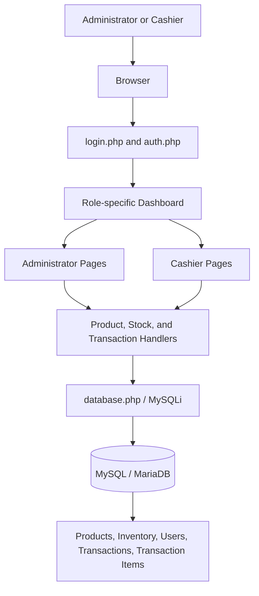

# Point of Sale (POS) — Web-based Cashier Application

This Point of Sale application was developed as a **Semester 2 web-development** course project. It models a small retail cashier workflow with separate administrator and cashier areas, product and stock management, and sales transaction records.

> **Project type:** Web application  
> **Project context:** Academic project — Semester 2  
> **Public showcase:** [POS-PWD-Showcase](https://github.com/SamuelPhe/POS-PWD-Showcase)

## 1. Application preview

The repository does not currently contain application screenshots. UI preview images can be added after capturing the application with fictional products, test accounts, and synthetic transactions.

Suggested screenshots:
- Login page
- Administrator dashboard
- Product and stock management
- Cashier checkout
- Transaction detail and payment summary

Do not publish real customer, cashier, or payment information.

## 2. Main features

- Login for **administrator** and **cashier** roles
- Role-specific dashboards
- Product and category management
- Inventory monitoring and stock adjustments
- Sales transaction processing
- Payment, paid amount, and change calculation
- Transaction history and detail views
- Separate transaction and stock actions for administrator and cashier workflows

## 3. Technology stack

- PHP
- MySQL / MariaDB
- MySQLi
- HTML and CSS
- JavaScript

## 4. Architecture overview

The application uses a page-oriented PHP structure. Login and authentication logic establish the user role, then the administrator and cashier pages expose their respective workflows. PHP action scripts process product, stock, and transaction changes through a shared MySQLi database connection.

## 5. Demo and local setup

The repository now includes a **static browser demo** in [`demo/index.html`](demo/index.html). It simulates administrator and cashier workflows, product catalog, inventory, checkout, payment calculation, and transaction history with fictional data. It does not connect to the original PHP/MySQL application.

To publish the demo, enable GitHub Pages at **Settings → Pages → Build and deployment → Source: GitHub Actions**, then run **Deploy browser demo** from the Actions tab. After deployment, the public URL will be: https://samuelphe.github.io/POS-pwd-semester2/.

The original PHP application can be run locally with PHP and MySQL or MariaDB.

1. Install PHP 8.x, MySQL or MariaDB, and a local web-server environment such as XAMPP.
2. Create/import the database using [database/schema.sql](database/schema.sql).
3. Configure these environment variables for PHP/Apache:
   - `DB_HOST` (default: `127.0.0.1`)
   - `DB_USERNAME`
   - `DB_PASSWORD`
   - `DB_DATABASE` (default: `pos`)
4. Place the project in the web server document root.
5. Open `login.php` through the local web server.
6. Create a local administrator account using a password hash. No demo credentials are published.

## 6. Database overview

The schema defines the core POS data:
- `users` — login identity and role
- `products` — product and category information
- `inventory` — stock quantities and locations
- `transactions` — transaction totals, payment, and change
- `transaction_items` — products and quantities recorded per transaction

## 7. Copyright and license

This is a collaborative academic project developed by the following team members:

- Chang Shau Liong
- Nathaniel Farrel
- Nicohlas
- Samuel

This attribution recognizes the project team and does not claim that the entire project or every contribution is solely owned by Samuel Phe. Ownership and rights in jointly created materials and individual contributions remain with the respective authors or rightsholders, subject to any applicable team, course, institutional, or other agreements.

No open-source license is granted by this repository for project materials created by the team. Permission to copy, modify, redistribute, sublicense, or reuse team-created materials should be obtained from the relevant rightsholders. Any third-party components and assets remain subject to their own licenses and notices. See the [LICENSE](LICENSE) file.
---

This is an academic portfolio project, not a production-ready payment or retail system. Further work is required for comprehensive CSRF protection, input validation, secure session/cookie configuration, and thorough transaction testing before real-world use.

## Project team and credits

This academic project was developed collaboratively by the following team members:

- Chang Shau Liong
- Nathaniel Farrel
- Nicohlas
- Samuel

The names above acknowledge the project team as a whole. Individual module-level responsibilities are not assigned here because a verified task-allocation record was not provided. This credit does not imply that every member authored every file or that each contribution was identical.

## Copyright and licensing

This is a collaborative academic project credited to the team members listed above. This notice does not assign or transfer copyright and does not make a legal determination about ownership of jointly created work. Rights in individual contributions remain with their respective authors or rightsholders, subject to any applicable team, course, institutional, or other agreements. No open-source license is granted by this repository. Permission to reuse team-created materials should be obtained from the relevant rightsholders. Third-party libraries and assets remain subject to their own licenses and notices. See [LICENSE](LICENSE).
